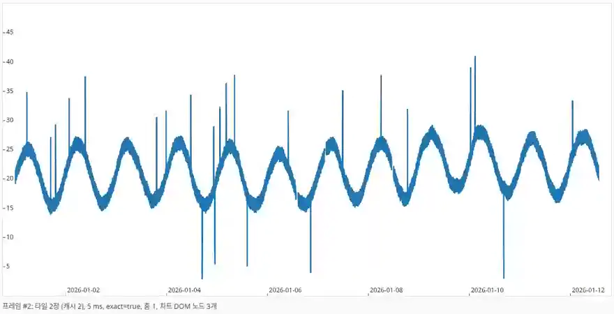
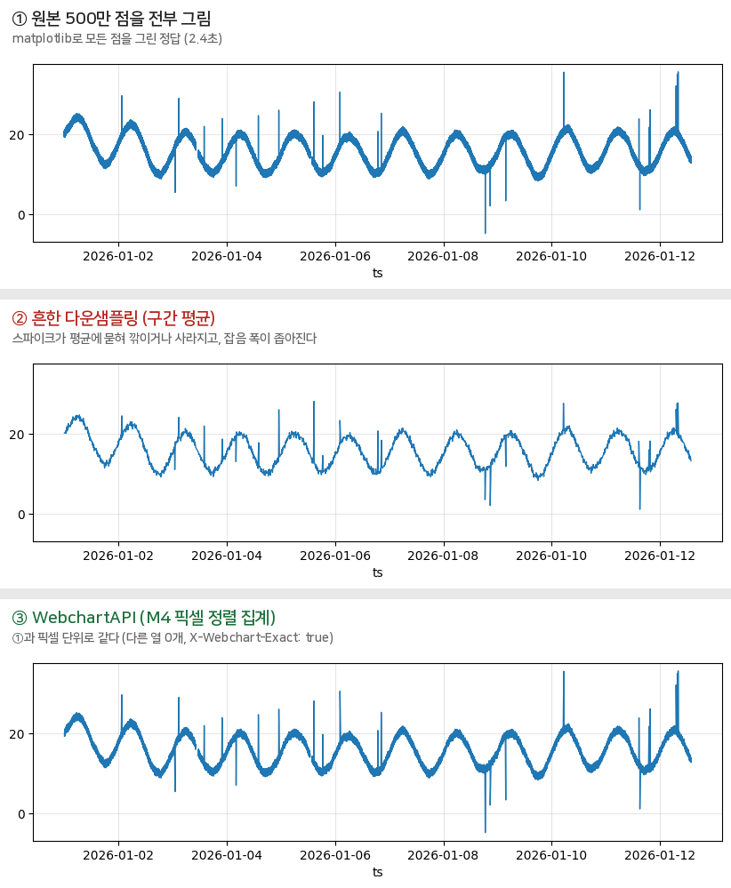
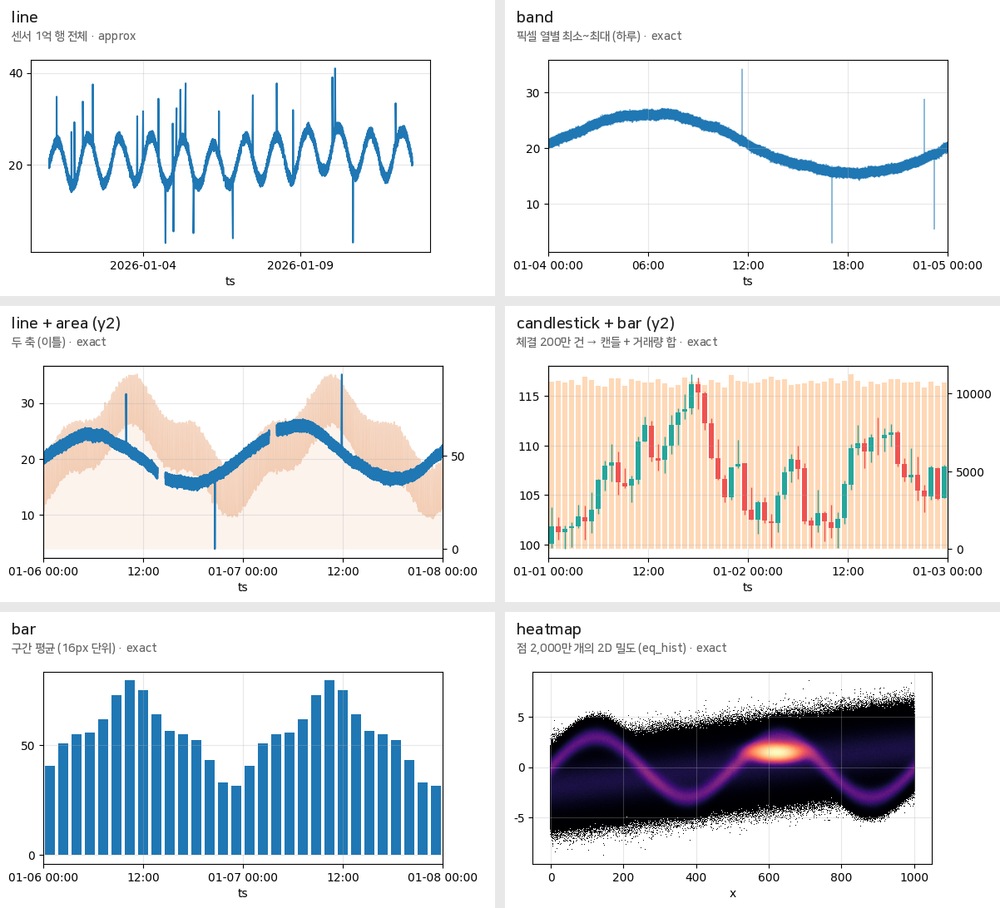
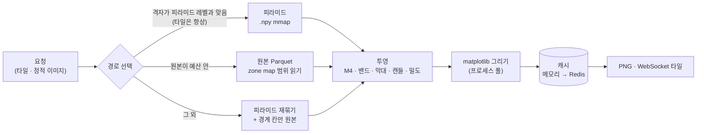

# WebchartAPI

**수억 행 데이터를 원본과 픽셀 단위로 같은 그림으로 그려 주는 서버사이드 차트 API**

Server-side chart rendering for hundreds of millions of rows — pixel-identical to plotting every point, streamed to a 3-node browser viewer.

[](LICENSE)




<sub>1억 행(10ms 간격, 11.6일) 센서 데이터를 레퍼런스 뷰어로 연 화면이다. 한 샘플짜리 스파이크를 향해 2배씩 16번 줌인해도 스파이크가 사라지지 않는다. 마지막에는 원본 점이 보이고, 호버하면 원본 값을, Shift+드래그하면 그 구간의 정확한 통계를 서버가 보내 준다. 브라우저 DOM은 차트당 3개다.</sub>

---

## 왜 만들었나

데이터가 수천만 행을 넘으면 브라우저 차트 라이브러리는 그대로 그리지 못한다. 보통은 점을 줄여서(다운샘플링) 보내는데, 이때 **그림이 바뀐다**.



같은 500만 행을 세 가지로 그렸다. ②처럼 구간 평균으로 줄이면 한 샘플짜리 이상치가 평균에 묻혀 깎이거나 사라지고, 잡음 폭도 좁아진다. 장애 신호를 찾으려고 보는 차트라면 가장 중요한 정보가 사라진 것이다. ③은 서버가 픽셀마다 필요한 점만 골라 그린 결과다. 모든 점을 그린 ①과 비교하면 **어긋난 픽셀 열이 0개**다(오라클 테스트와 같은 기준: 안티에일리어싱 차이 세로 1px 허용).

WebchartAPI는 이 "원본과 같은 그림"을 약속으로 삼는다.

- **무거운 일은 서버가 한다.** 집계와 렌더링을 RAM 큰 서버가 맡고, 결과는 PNG 이미지나 타일로 보낸다.
- **브라우저는 가볍다.** 레퍼런스 뷰어는 프레임워크 없는 JS 파일 하나(약 14KB)이고 DOM은 차트당 3개다.
- **인터랙션은 스트리밍이다.** 줌·이동·호버·구간 통계를 WebSocket으로 주고받는다. 빠르게 휠을 굴리면 지난 요청은 서버에서 취소된다.
- **"왜곡 없음"은 테스트로 지킨다.** 서버가 그린 그림을 원본 전체를 그린 그림과 픽셀 단위로 비교하는 오라클 테스트가 있다. 정확하지 않은 경로를 타면 응답에 `exact=false`를 붙인다.

---

## 그릴 수 있는 차트



| 레이어 | 픽셀(또는 구간)마다 남기는 값 | 보장 |
|---|---|---|
| `line`, `area` | 첫 점·최솟값·최댓값·끝 점 (M4) | 원본을 모두 그린 그림과 같다 |
| `band` | 최솟값 ~ 최댓값 | 열마다 원본과 같은 값 |
| `bar` | 구간의 sum / mean / count / min / max | 구간 원본 행의 정확한 집계 |
| `candlestick` | 구간 OHLC (가격 컬럼 하나 또는 OHLC 컬럼 네 개) | 정확 |
| `scatter`, `heatmap` | 픽셀마다 점 개수 (2D 밀도, linear / log / eq_hist) | 개수가 원본과 같다 |

레이어는 여러 개를 겹치고, 오른쪽 축(`y2`)을 따로 쓸 수 있다. 시간축 눈금은 지정한 시간대의 벽시계에 맞춘다.

<sub>위 갤러리의 `approx`: 1억 행 전체 범위의 정적 이미지는 원본 읽기 예산(기본 2,000만 행)을 넘어서 미리 집계한 피라미드로 그렸다. 이때 오차는 가장 세밀한 집계 칸 하나 폭(이 그림에서는 픽셀 폭의 1/1,000보다 작다) 이내이고, 응답 헤더에 `X-Webchart-Exact: false`로 표시된다. 인터랙티브 타일은 항상 정확하다.</sub>

---

## 빠르게 시작하기

Python 3.11 이상과 Redis가 필요하다.

```bash
# Docker (API + Redis)
docker-compose up -d

# 또는 직접
pip install -e .                    # S3·FTP·SFTP·SMB·ClickHouse 커넥터까지: pip install -e ".[connectors]"
docker run -d -p 6379:6379 redis:7-alpine
WEBCHART_DATA_DIR=./data uvicorn webchart.main:app --port 8000
```

**1. 데이터 올리기** (CSV, Parquet, JSON, Excel, TSV). 서버가 x축으로 정렬된 Parquet으로 바꿔 둔다.

```bash
curl -F file=@sensor.csv http://localhost:8000/api/v1/datasets/upload
# {"dataset_id": "3f2c…", "status": "ingesting"}
```

**2. 피라미드 만들기** (수천만 행 이상일 때). 줌아웃 화면을 미리 집계해 두어 1억 행 전체 화면도 0.1초 안팎에 그린다.

```bash
curl -X POST http://localhost:8000/api/v1/datasets/3f2c…/pyramid \
     -H 'Content-Type: application/json' -d '{"x_column": "ts"}'
```

**3. 이미지 한 장 받기**

```bash
curl -X POST http://localhost:8000/api/v1/charts/render -H 'Content-Type: application/json' \
     -d '{"dataset_id": "3f2c…", "x_axis": {"column": "ts"},
          "layers": [{"kind": "line", "column": "temp"}]}' -o chart.png
```

**4. 인터랙티브 뷰어**: 브라우저에서 `http://localhost:8000/viewer/`를 연다. 드래그로 이동, 휠로 줌, Shift+드래그로 구간 통계를 본다. 뷰어는 [`src/webchart/web/webchart.js`](src/webchart/web/webchart.js) 하나라 다른 페이지에 그대로 넣을 수 있다.

**5. 다른 페이지에 넣기**: 차트를 등록하면 ``로 쓸 수 있는 URL과 XYZ 타일 URL이 나온다. 같은 차트는 항상 같은 URL이라 CDN·브라우저 캐시가 그대로 먹힌다.

### 차트 명세 예시

```jsonc
{
  "dataset_id": "…",
  "x_axis": { "column": "ts", "timezone": "Asia/Seoul" },
  "layers": [
    { "kind": "candlestick", "column": "price", "group_px": 16 },
    { "kind": "line", "column": "ma20", "style": { "color": "#e45" } },
    { "kind": "bar", "column": "volume", "agg": "sum", "axis": "y2" }
  ],
  "axes": { "y": { "label": "price" }, "y2": { "label": "volume", "range_policy": "viewport" } },
  "width": 1200, "height": 600
}
```

- y범위 정책: `global`(전체 데이터 기준, 캐시 효율 최고), `viewport`(보이는 구간), `fixed`(`range` 지정)
- 시간대: ① `x_axis.timezone` ② 컬럼에 저장된 시간대 ③ 시간대 없는 컬럼은 저장된 값 그대로
- 이전 형식(`chart_type`, `y_columns`)도 받는다. 자동으로 레이어로 바뀐다.

---

## 어떻게 왜곡 없이 그리나

### 1. 픽셀 경계 = 집계 경계

선 차트에서 한 픽셀 열에 보이는 것은 그 열에 들어온 점들의 **첫 점, 최솟값, 최댓값, 끝 점**뿐이다. 이 네 점만 남겨 그리면 모든 점을 그린 그림과 같다. 단, 집계 구간의 경계가 픽셀 경계와 정확히 맞아야 한다 (M4, Jugel et al., PVLDB 2014).

WebchartAPI는 x 전체를 2<sup>L</sup>칸으로 나눈 격자 하나를 모든 곳(피라미드, 타일, 정적 이미지)에서 같이 쓴다. 줌 z의 타일은 레벨 z + log2(타일 px)의 칸을 그대로 픽셀 열로 쓰므로 경계가 항상 맞는다.

### 2. 합쳐도 정확한 집계 (BucketStats)

칸마다 `개수, 합, 첫 점, 끝 점, 최솟값(+x), 최댓값(+x), 결측 위치`를 저장한다. 두 칸을 합친 결과가 두 칸의 원본을 한 번에 집계한 결과와 같아서 다음이 모두 가능하다.

- 세밀한 레벨을 2칸씩 합쳐 위 레벨을 만든다 (피라미드)
- 실시간으로 들어온 행을 다시 집계하지 않고 기존 칸에 더한다
- 저장 구조 하나로 모든 차트 종류를 만든다

### 3. 요청마다 가장 싼 정확한 경로



| 저장 계층 | 내용 |
|---|---|
| 원본 | x축으로 정렬한 Parquet (131,072행 단위). 단위마다 x 범위를 기억해 필요한 부분만 읽는다 |
| 피라미드 | 레벨별 `.npy` 배열을 mmap으로 연다. OS 페이지 캐시가 그대로 메모리 계층이 된다 |
| L1 / L2 캐시 | 프로세스 메모리 LRU → Redis. 실시간 추가가 닿지 않은 타일은 캐시를 계속 쓴다 |

코드 구조와 설계 근거, 측정 기록은 [docs/improvement-plan.md](docs/improvement-plan.md)에 있다.

---

## 성능

16코어, RAM 125GB, 시리즈 2개, 캐시 없이 처음 그릴 때.

| 단계 | 2,000만 행 | 1억 행 |
|---|---:|---:|
| 인제스트 (정렬 + 변환) | 6.5s | 17.4s |
| 피라미드 빌드 | 2.3s (420MB) | 17.8s (1.9GB) |
| 타일 1장, 전체 화면 (피라미드) | 0.03s | 0.03s |
| 타일 1장, 깊은 줌 (원본 범위 읽기) | 0.02s | 0.03s |
| 정적 이미지, 전체 범위 | 1.2s (원본, exact) | 0.11s (피라미드) / 5.6s (원본, exact) |
| 타일 64장 한 화면 (그리기 프로세스 8) | — | 0.28s |

1억 행에서 휠 줌·드래그를 2.8초 동안 40번(viewport 요청 72개) 몰아 보내도, 중간 프레임은 모두 취소되고 마지막 입력 0.26초 뒤에 최종 화면이 왔다. 측정 스크립트는 [`scripts/bench/`](scripts/bench/)에 있다.

---

## API

<details>
<summary><b>데이터셋</b></summary>

| Method | Endpoint | 설명 |
|---|---|---|
| POST | `/api/v1/datasets/upload` | 파일 업로드. 정렬된 Parquet으로 변환 (백그라운드) |
| POST | `/api/v1/datasets/connect` | 원격 소스: S3, HTTP, FTP, SFTP, SMB, ClickHouse, 로컬 파일 |
| GET | `/api/v1/datasets`, `/{id}`, `/{id}/schema`, `/{id}/preview` | 조회 |
| POST | `/api/v1/datasets/{id}/pyramid` | 피라미드 빌드 |
| POST | `/api/v1/datasets/{id}/rows` | 실시간 추가 `{"columns": {"ts": [...], "temp": [...]}}` |
| DELETE | `/api/v1/datasets/{id}` | 삭제 (캐시·세션도 정리) |

</details>

<details>
<summary><b>차트 · 임베드</b></summary>

| Method | Endpoint | 설명 |
|---|---|---|
| POST | `/api/v1/charts/render` | 이미지 한 장. 헤더 `X-Webchart-Exact`, `X-Webchart-Source`, `X-Data-Points` |
| POST | `/api/v1/charts` | 차트 등록 → `chart_id`(명세의 내용 해시)와 임베드 URL |
| GET | `/api/v1/charts/{id}/image.png?x0&x1&w&h` | ``용. ETag/304 |
| GET | `/api/v1/charts/{id}/tiles/{z}/{i}@{dpr}x.png` | XYZ 타일 (CDN 캐시 가능) |

인증을 켜면 임베드·타일 URL에는 API 키 대신 그 차트에만 유효한 HMAC 토큰이 붙는다.

</details>

<details>
<summary><b>인터랙티브 세션 (WebSocket v2)</b></summary>

`POST /api/v1/sessions` → `WS /api/v1/ws/{session_id}`

| 클라이언트 → 서버 | 서버 → 클라이언트 |
|---|---|
| `viewport {req_id, x_range, zoom?, width_px, height_px, dpr}` | 이전 프레임 취소 → `frame_begin`(타일 목록, 축별 y범위, x·y 눈금) → 타일(보이는 것부터) → `frame_end` |
| `hover {req_id, pixel_x}` | `crosshair`: 시리즈마다 가장 가까운 원본 값 |
| `select {req_id, x_range}` | `range_stats`: 구간 count / min / max / mean / first / last (정확) |
| `ping` | `pong` |

- 데이터가 추가되면 `data_appended`(바뀐 x 구간)가 온다. 워커가 여러 개여도 Redis pub/sub으로 모두 받는다.
- 타일 바이너리 헤더(13바이트, big-endian): `[magic 0x57][version 2][req_id u32][zoom u8][index u32][dpr u8][format u8]` + PNG

</details>

<details>
<summary><b>운영</b></summary>

| Endpoint | 설명 |
|---|---|
| `/health` | 상태 |
| `/metrics` | Prometheus 형식: 캐시 적중(L1/L2), 렌더 지연, 경로별 exact 비율 |
| `/docs` | OpenAPI 문서 (FastAPI) |

</details>

---

## 설정

모든 설정은 `WEBCHART_` 접두사 환경변수로 바꾼다. 전체 목록은 [src/webchart/config.py](src/webchart/config.py)에 있다.

<details>
<summary>자주 바꾸는 설정</summary>

| 변수 | 기본값 | 설명 |
|---|---|---|
| `REDIS_URL` | `redis://localhost:6379/0` | 캐시·세션 |
| `DATA_DIR` | `/data/webchart` | 데이터 저장 경로 |
| `API_KEYS` | 비움 | API 키 목록 (JSON 배열). **비우면 인증이 꺼진다 (개발용)** |
| `EMBED_SECRET` | 비움 | 임베드 토큰 HMAC 비밀값. 비우면 `API_KEYS`에서 만든다 |
| `CORS_ALLOW_ORIGINS` | `["http://localhost:3000"]` | 허용할 브라우저 출처 |
| `RATE_LIMIT_PER_MINUTE` | 120 | API 키(없으면 IP)별 분당 요청 수 |
| `TILE_SIZE` | 512 | 타일 px (2의 거듭제곱) |
| `RENDER_POOL_SIZE` | 8 | 데이터 읽기·집계 스레드 수 |
| `PAINT_PROCESSES` | `min(8, CPU/2)` | matplotlib 그리기 프로세스 수 (0이면 스레드) |
| `TILE_MEMORY_CACHE_BYTES` | 512MB | 메모리 타일 캐시 상한 |
| `PYRAMID_MAX_LEVEL` / `PYRAMID_MAX_BYTES` | 24 / 4GB | 피라미드 깊이·크기 상한 |
| `EXACT_RAW_ROW_BUDGET` | 20,000,000 | 정적 이미지에서 원본을 직접 읽을 행 수 상한 |
| `MAX_UPLOAD_SIZE` | 10GB | 업로드·원격 다운로드 크기 상한 |
| `BLOCK_PRIVATE_EGRESS` | `true` | 원격 커넥터가 사설·루프백 주소에 접속하지 못하게 막는다 |
| `LOCAL_INGEST_ROOT` | 비움 | `file://` 인제스트가 읽을 수 있는 디렉터리. 비우면 거부 |
| `CONNECTOR_TIMEOUT` | 300 | 원격 다운로드·쿼리 제한 시간 (초) |
| `LIVE_EVENTS` | `redis` | 실시간 추가 알림을 워커끼리 나누는 방법 (`redis` 또는 `local`) |
| `TILE_CACHE_TTL` / `SESSION_TTL` | 3600 / 900 | Redis 타일·세션 유지 시간 (초) |

</details>

---

## 보안

공개된 곳에 띄우기 전에 확인할 것.

- **인증을 켠다.** `WEBCHART_API_KEYS`가 비어 있으면 누구나 업로드·조회·삭제할 수 있고, 세션 ID만 알면 남의 세션도 열 수 있다.
- **원격 커넥터는 서버가 대신 외부에 접속하는 기능이다.**
  - 사설·루프백·링크로컬 주소는 기본으로 막는다(`BLOCK_PRIVATE_EGRESS`). 내부 MinIO처럼 의도한 경우에만 끈다.
  - HTTP·FTP·SFTP·ClickHouse는 검사를 통과한 IP로만 접속한다(DNS 리바인딩 방지). S3 사용자 엔드포인트와 SMB는 라이브러리 구조상 접속할 때 DNS를 다시 풀므로 신뢰하는 주소에만 쓴다.
  - 받은 양이 `MAX_UPLOAD_SIZE`를 넘는 순간 끊는다. 원격이 알려 주는 크기를 믿지 않는다.
  - 다른 호스트로 리다이렉트되면 인증 헤더를 보내지 않는다. FTP 데이터 연결은 PASV 응답의 주소가 아니라 접속한 서버로 연다.
- **`file://` 인제스트**는 `LOCAL_INGEST_ROOT` 안만 읽는다 (기본 꺼짐).
- **브라우저 WebSocket**은 헤더를 붙일 수 없어 API 키를 `?api_key=` 쿼리로도 받는다. 프록시·접근 로그에 남을 수 있으니 공개 환경에서는 로그에서 쿼리를 지우거나 수명이 짧은 키를 쓴다.
- **임베드·타일 URL**의 HMAC 토큰은 키를 바꾸면 무효가 된다. 운영에서는 `EMBED_SECRET`을 따로 지정한다.

보안 문제를 발견하면 공개 이슈 대신 저장소 관리자에게 먼저 알려 주면 좋겠다.

---

## 개발

```bash
pip install -e ".[dev]"
pytest tests/                       # 오라클 포함 (tests/oracle/)
ruff check src/ tests/ scripts/ && mypy --strict src/webchart/domain
```

- `tests/oracle/`는 합성 데이터(스파이크, 결측, 불규칙 간격, 여러 시리즈, 시간축, 실시간 추가)로 서버 결과를 원본 전체 렌더와 비교한다.
- 렌더 경로(집계·투영·그리기)를 바꾸면 오라클을 꼭 돌린다. 근사가 생기면 응답에 `exact=false`로 드러나야 한다.
- 주석·docstring은 한국어, 식별자는 영어다. 이름에 단위를 붙이고(`width_px`, `x_ns`), 범위는 반열린 구간 `[start, end)`로 쓴다. 자세한 규칙은 계획 문서 6장에 있다.
- `domain/`은 numpy만 쓰고 `mypy --strict`를 통과해야 한다.
- README 이미지는 [`scripts/readme/make_assets.py`](scripts/readme/make_assets.py)가 합성 데이터로 실제 서버를 돌려 만든다. 렌더가 바뀌면 다시 만든다.

---

## 라이선스

[MIT](LICENSE). 상업적 이용을 포함해 자유롭게 쓰고 고치고 배포할 수 있다. 복사본에는 저작권·라이선스 문구를 남겨야 한다.

포크하거나 일부를 가져다 쓸 때 이 저장소(https://github.com/azxcv24/WebchartAPI)를 출처로 밝혀 주면 고맙겠다. 라이선스 의무가 아니라 부탁이다.

### 함께 쓰는 오픈소스와 참고한 연구

| 프로젝트 | 쓰는 곳 | 라이선스 |
|---|---|---|
| [FastAPI](https://github.com/fastapi/fastapi), [Starlette](https://github.com/encode/starlette), [Pydantic](https://github.com/pydantic/pydantic), [Uvicorn](https://github.com/encode/uvicorn) | API 서버, WebSocket, 설정 | MIT / BSD-3-Clause |
| [Apache Arrow (pyarrow)](https://github.com/apache/arrow) | Parquet 범위 읽기 | Apache-2.0 |
| [NumPy](https://github.com/numpy/numpy), [pandas](https://github.com/pandas-dev/pandas), [Dask](https://github.com/dask/dask) | 집계, 인제스트 | BSD-3-Clause |
| [Matplotlib](https://github.com/matplotlib/matplotlib), [Pillow](https://github.com/python-pillow/Pillow) | 그리기, PNG 인코딩 | Matplotlib License / MIT-CMU |
| [redis-py](https://github.com/redis/redis-py), [HTTPX](https://github.com/encode/httpx) | 캐시·세션, HTTP 커넥터 | MIT / BSD-3-Clause |

- **M4 집계**: U. Jugel, Z. Jerzak, G. Hackenbroich, V. Markl, "M4: A Visualization-Oriented Time Series Data Aggregation", *PVLDB* 7(10), 2014.
- **밀도 정규화(eq_hist)**는 [Datashader](https://github.com/holoviz/datashader)의 방식을 참고했다.
